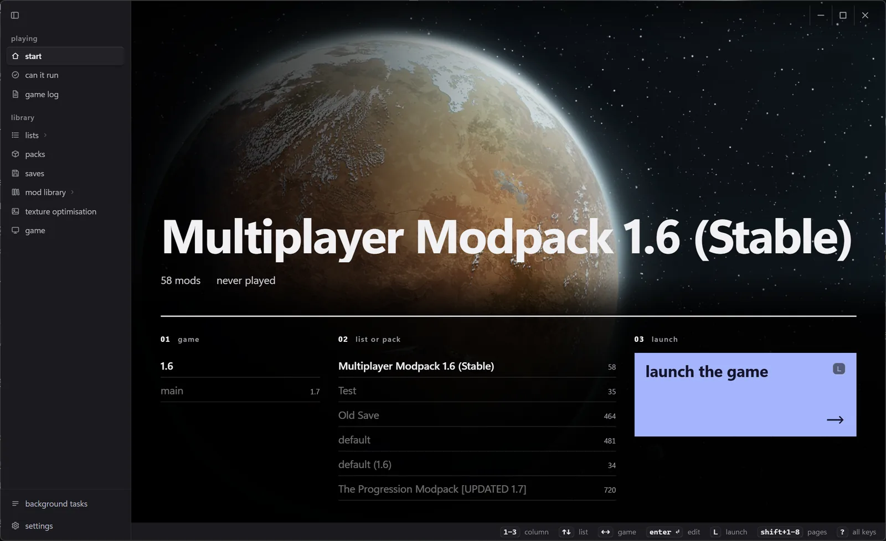
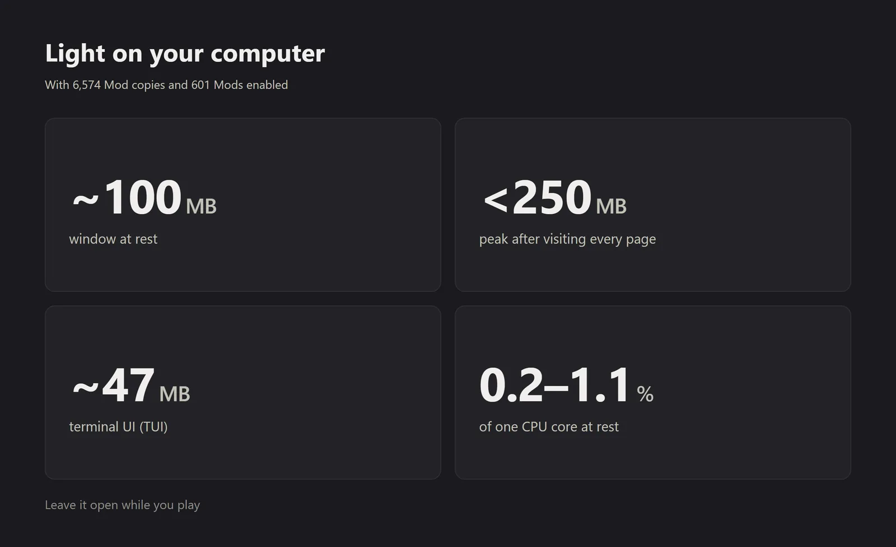
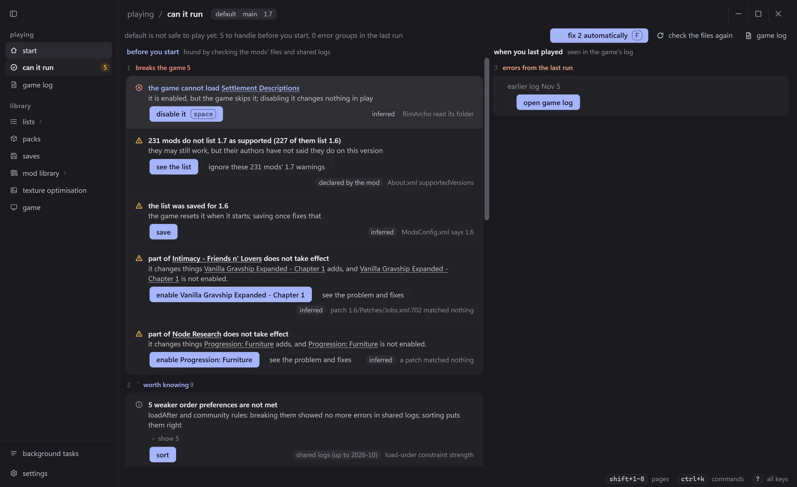
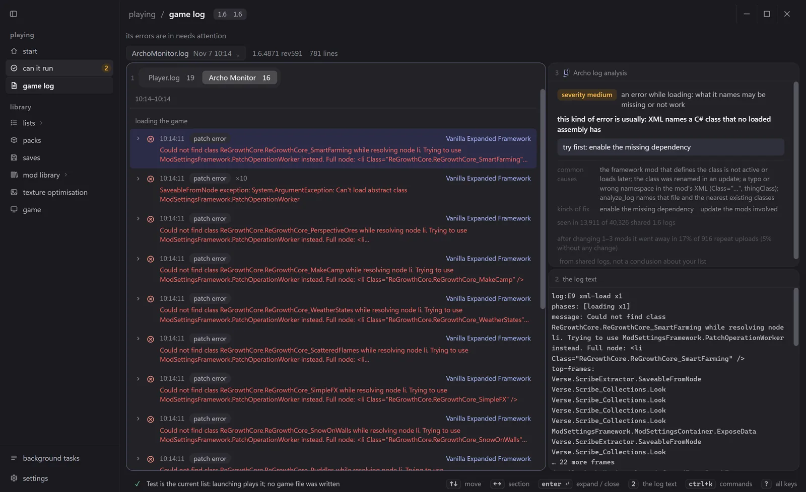
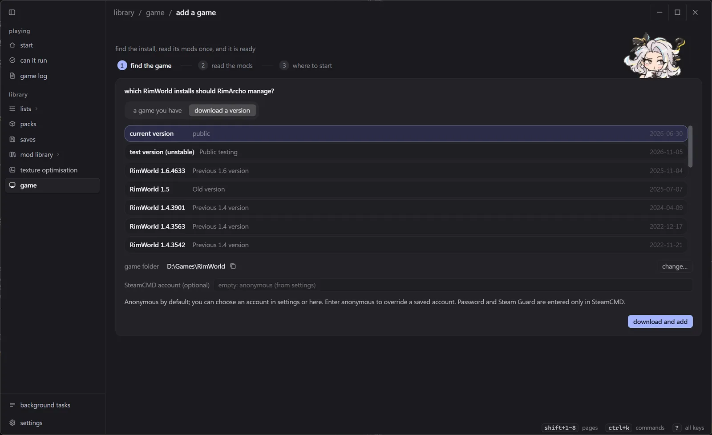
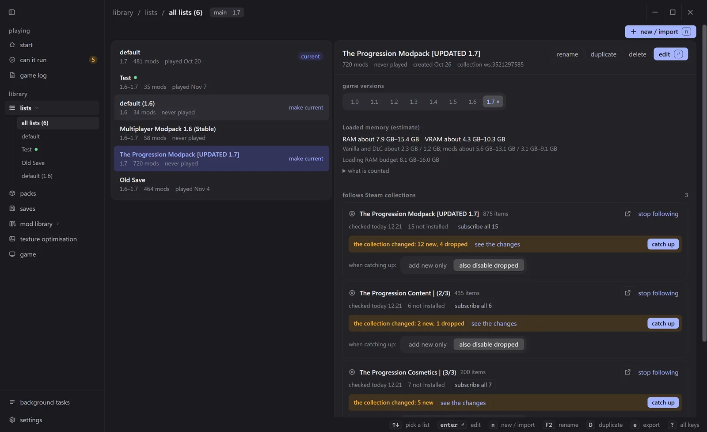
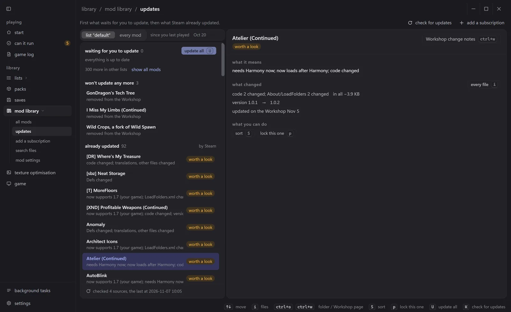
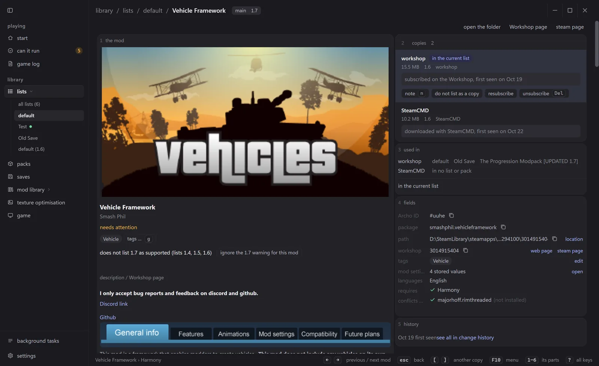
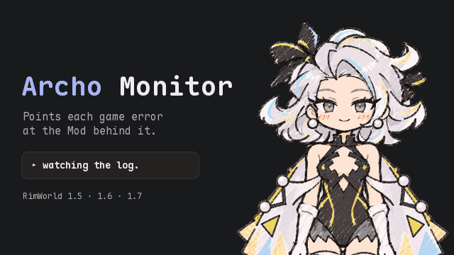
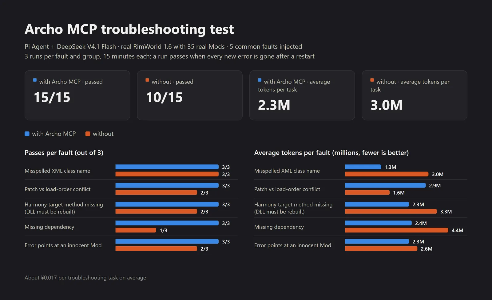

English | [&#31616;&#20307;&#20013;&#25991;](README.zh-CN.md)

<div align="center">


# RimArcho

**A RimWorld launcher and Mod manager that looks past your current list.**<br>
Game versions, playthroughs and saves, one click apart. When something breaks, your AI agent launches the game and finds the culprit: no more halving your Mod list for hours.

[](https://github.com/ToumanLin/RimArcho/releases/latest)
[](https://github.com/ToumanLin/RimArcho/releases)
[](LICENSE)
[](go.mod)
<br>
[-0078d4)](#install)
[](https://rimworldgame.com/)
[](internal/l10ndata/locale)
[](#ai-agents-and-mcp)
[](https://discord.gg/HF2GVyurQs)

[Download](https://github.com/ToumanLin/RimArcho/releases/latest) ·
[User guide](UserGuide/user-guide.md) ·
[Changelog](CHANGELOG.md) ·
[Discord](https://discord.gg/HF2GVyurQs)

</div>



I've played RimWorld for 1,600 hours, and I suspect many of you are like me: you sit down to play,
and most of the evening goes into sorting the Mod list, relaunching and chasing errors. RimArcho
exists to give that time back. It is free and open source under the MIT license.

## Contents

- [Highlights](#highlights)
- [A check-up before you launch](#a-check-up-before-you-launch)
- [Lists and games](#lists-and-games)
- [Mod library](#mod-library)
- [Saves](#saves)
- [Archo Monitor](#archo-monitor)
- [AI agents and MCP](#ai-agents-and-mcp)
- [Install](#install)
- [Privacy and safety](#privacy-and-safety)
- [Code signing policy](#code-signing-policy)
- [FAQ](#faq)
- [Links](#links)

## Highlights

- **Light** — With 6,574 Mod copies and 601 Mods enabled: about 100 MB at rest, under 250 MB after visiting every page, about 47 MB in the terminal UI, 0.2–1.1 % of one CPU core at rest. Leave it open while you play.
- **Built on real data** — Sorting and conflict checks were iterated on 40,326 error logs shared by players and 5,143 downloaded Mods.
- **Will it run?** Dependencies, load order, patches, Harmony patches, memory and your last save are checked before the game starts.
- **Readable logs** — Errors are grouped, rated by how much they matter and pinned on the Mod behind them.
- **Lists and games** — Several lists, several game installs (1.6 and 1.7 side by side) sharing one set of Mods, full undo history.
- **Three faces, one program** — A desktop window, a terminal UI, a scriptable CLI and an MCP server for AI agents, all showing the same facts.
- **Bring your data** — Import lists, rules and data from RimSort, RimCrow, RimPy and RimStack.

<p align="center"></p>

## A check-up before you launch

**Can it run** looks at your list before the game does:

- **Sorting.** RimArcho's own sorting algorithm, grown from the shared logs, and it explains each
  constraint it follows. It also tells you which Mods tend to fail together and suggests disabling one.
- **Static checks.** Missing and inactive dependencies, incompatibilities, load order. Defs are merged
  and inherited the way the game does and PatchOperations are simulated, so a failed patch comes with
  a reason. Harmony patches are read straight from the Mods' assemblies (DLLs). This can't catch
  conflicts that only appear while the game runs, but it finds many problems in advance.
- **Your save.** RimArcho reads which Mods your last save uses and compares them with the current
  list, so you know whether it will still load after you change the list.
- **Memory.** It estimates the RAM and VRAM your list needs and warns you if your computer can't
  handle it, instead of crashing after a 20-minute load.



**Game log.** RimArcho reads the log the game writes while you play and sums up what went wrong,
so you don't get lost in ten thousand lines. Based on the 40,326 logs, every kind of error gets a
severity: most of the red and yellow text can safely be ignored, and the errors that need attention
are picked out for you, each with the Mod behind it, the evidence and what to try first.



## Lists and games

Keep several lists, and let several game installs share one set of downloaded Mods. RimArcho links
Mods into each game (directory junctions on Windows, symbolic links on Linux), so one copy of a Mod
works in every install, and RimWorld 1.6 and 1.7 can live side by side. It can also download other
game versions with SteamCMD.



Lists can follow a Steam collection and catch up when it changes. List history records every
change, so you can roll back at any time. **Lock version** copies the Mod you're using into a locked
copy, so Steam's automatic updates can't overwrite it.



## Mod library

RimArcho shows what each Mod update changed: no more staring at "Updating RimWorld: Steam Workshop"
and wondering which Mod it was.



The details page shows the Steam Workshop description instead of an About.xml most authors never
fill in, every copy of the Mod and the lists that use it.



- Add Mods from Steam Workshop, GitHub and LoversLab links, and they update when the Mods do.
- Texture optimisation uses [todds](https://github.com/joseasoler/todds) to convert the PNGs in your
  Mods to DDS, lowering the game's memory use. The PNGs stay, and RimArcho can take the DDS files back.
- Search the files of every Mod, and change Mod settings without starting the game.

## Saves

Saves are grouped into colonies, so no more staring at "New Arrival 43" with no idea what it is.
Colony grouping understands the RimSaves file names. For each save RimArcho reads which Mods it uses
and tells you whether removing one loses content and whether the save still loads.

## Archo Monitor



Archo Monitor is RimArcho's in-game companion Mod, bundled with every release and added to your
lists for you. It records what `Player.log` cannot say: the XML file and Def being loaded when an
error happens, which Mods own the code and Harmony patches on the stack, and how many errors came
after the game stopped logging. RimArcho reads its log to show evidence for each problem.

It changes nothing in the game, can be added or removed at any time and costs next to nothing. It
works without RimArcho too: **Errors by Mod…** in its Mod settings lists this session's errors
grouped by Mod. RimWorld 1.5, 1.6 and 1.7; needs Harmony.

<br clear="right">

## AI agents and MCP

Everything works without AI. AI agents are RimArcho's second kind of user: through MCP they get the
same facts and the same actions as you, and follow the same rules. Nothing is written to the game
until a list is saved or launched, and edits can be undone. A built-in AI agent is on the way.

**To set it up, give this README to your AI agent** (Codex, Claude Code, Pi Agent, DeepSeek Harness…)
and it can install everything itself, following [Install](#install) and
[Connecting an agent](#connecting-an-agent-archo-mcp).

The MCP server has 47 tools with progressive disclosure (30 served by default): read Mods, Defs,
patches, Harmony patches, logs, Mod settings, saves and C# source; edit, save and launch lists; and
test runs that start the game by themselves. RimArcho also ships the
[RimWorld Probe skill](skills/rimworld-probe/SKILL.md), which lets an agent build small test Mods,
run them in the game and check what a behaviour actually does.

**Archo MCP troubleshooting test.** An A/B test in Pi Agent with DeepSeek V4.1 Flash, on a real
RimWorld 1.6 with 35 real Mods and 5 kinds of common faults injected. The agent has to find the Mod
at fault and submit a fix; a run passes only when every new error is gone after the game restarts.
Each fault ran 3 times per group, 15 minutes per run.

| Fault | With Archo MCP | Without |
| --- | --- | --- |
| Misspelled XML class name | 3/3 · 1.3M tokens | 3/3 · 3.0M |
| Patch conflicts with load order | 3/3 · 2.9M | 2/3 · 1.6M |
| Harmony patch target method missing (DLL must be rebuilt) | 3/3 · 2.3M | 2/3 · 3.3M |
| Missing dependency | 3/3 · 2.4M | 1/3 · 4.4M |
| Error points at an innocent Mod | 3/3 · 2.3M | 2/3 · 2.6M |
| **Total** | **15/15** · average 2.3M | 10/15 · average 3.0M |

Archo MCP makes the agent better at finding and fixing errors, with fewer tokens: about $0.003 per fix.

<p align="center"></p>

## Install

### Requirements

| Platform | Needs |
|---|---|
| Windows | Windows 10 or 11, 64-bit. The window needs Microsoft Edge WebView2, which both already have. |
| Linux (experimental) | `archo` (terminal UI, CLI, MCP) needs nothing installed. The window, `rimarcho`, needs GTK 3 and WebKitGTK 4.1 (Ubuntu 22.04, Debian 12, Fedora 40 or newer). Native, Proton and Flatpak Steam games are found. |
| RimWorld | 1.6 and 1.7 (Steam, SteamCMD or DRM-free copies). |
| Optional | [ilspycmd](https://github.com/icsharpcode/ILSpy) (needs the .NET SDK) to read Mods' C# code; RimArcho never installs it for you. |

### Windows

1. Download `archo-<version>-windows-amd64.zip` from
   [GitHub Releases](https://github.com/ToumanLin/RimArcho/releases/latest) (or, if GitHub is
   unreachable, from [Lanzou](https://rimarcho.lanzn.com/b01i608qja), password `ctot`).
2. **New users:** unzip it into any folder, for example `C:\Tools\RimArcho\`, and double-click
   `RimArcho.exe`. A first-run guide finds your games, reads your Mods once and offers to bring your
   lists over from the game, RimSort, RimCrow, RimPy or RimStack.
3. **Existing users:** RimArcho updates itself (Settings › About, or `archo update`). By hand, replace
   your old `RimArcho.exe` and `archo.exe` with the new ones.
4. Optional: add the folder to `PATH` to type `archo` in any terminal.

Releases are code-signed once signing is set up (see [Code signing policy](#code-signing-policy)).
The first time you run an unsigned one, Windows may say "Windows protected your PC": choose **More
info**, then **Run anyway**. Each release has a `.sha256` checksum, and you can build it yourself
from this source (below). If Windows says you have no permission even as administrator, see the
FAQ ("RimArcho.exe won't start").

### Linux (experimental)

Download `archo-<version>-linux-amd64.tar.gz`, extract it anywhere and run `./archo` (terminal UI)
or `./rimarcho` (window). Linux support is new and still being tested, so expect rough edges and
keep a backup of your saves and Mod lists. RimArcho does not update itself
on Linux; `archo update` shows the new version and how to install it. Texture optimisation needs a
native `todds` on `PATH`. Please report problems on GitHub.

### Build from source

Go 1.27 or newer: `go build -o archo.exe ./cmd/archo`, or `pwsh scripts/release.ps1 -Version x.y.z`
for a release zip with the version stamped in. Architecture and specifications are in
[docs/](docs/README.md).

### First run from the command line

```
archo env detect                 # finds the game, the user data folder and the Workshop folder
archo env add main --detected    # registers them as Game Config "main"
archo scan                       # reads every Mod folder (incremental afterwards)
archo status                     # overview: Mods, the list, problem counts
archo problems                   # what is wrong, most severe first
archo log                        # attribute the newest Player.log
```

Then double-click `RimArcho.exe` for the window, or run `archo` for the terminal UI. `archo help`
lists every command; `archo <command> --help` shows its flags.

### Connecting an agent (`archo mcp`)

`archo mcp` serves the RimArcho tools over stdio. By default it serves the core tools an agent needs
to diagnose and fix a Mod list. `archo mcp --tools all` adds the player's management tools (packs,
subscriptions, library actions, textures, the memory estimate, maintenance, identity, hidden Mods,
links, tags and notes, the uninstall preview); add it only when you want the agent to do those too,
since every tool costs context on each turn. Each tool returns exactly what the matching CLI command
prints; read-only tools are annotated `readOnlyHint`, tools that write game or Mod files
`destructiveHint`.

**Claude Code**, from a terminal:

```
claude mcp add rimarcho -- C:\Tools\RimArcho\archo.exe mcp
```

Or in a project's `.mcp.json`:

```json
{
  "mcpServers": {
    "rimarcho": { "command": "C:\\Tools\\RimArcho\\archo.exe", "args": ["mcp"] }
  }
}
```

**Codex**, in `~/.codex/config.toml`:

```toml
[mcp_servers.rimarcho]
command = 'C:\Tools\RimArcho\archo.exe'
args = ["mcp"]
```

`"args": ["mcp", "--tools", "all"]` serves the management tools too. Then ask, for example: "My log
has `Patch operation … failed` errors, which Mod is wrong?" or paste a stack trace. A tool call can
pass `env` to use another Game Config and `game_version` to analyse as another game version. The
`guide` tool gives each tool's full reference, so the agent needs no extra skill.

<details>
<summary><b>Keys (window and terminal)</b></summary>

Both interfaces follow one rule set: **the arrows only move** and never change anything; **keys that
change things act at once** on the selection and `u` undoes them.

| Keys | |
|---|---|
| `↑/↓`, `←/→`, `1`–`4` | move the cursor; go to Disabled, Enabled, Staging, details |
| `shift+↑/↓`, `ctrl+space` | select a range; select or unselect one |
| `space` | enable / disable / put back from staging |
| `t`, `T` | stage (or put back); put everything back |
| `m`, `J` / `K` | move to a position or after a Mod; move down / up |
| `enter`, `o` | full details; the Workshop page |
| `S` / `w` / `L` | sort / save to the game / launch (each shows a preview first) |
| `u` / `ctrl+r` | undo / redo (the window also takes `ctrl+z` / `ctrl+y`) |
| `/` | search: words, `tag:`, `author:`, `type:`, `has:`, `location:`, `-not` |
| `ctrl+k`, `?` | command palette; all keys |

In the window, the mouse does the same: click, `shift`/`ctrl`+click, double-click to enable or
disable, drag between lists or within Enabled, right-click for what you can do with the Mod.

</details>

## Privacy and safety

RimArcho is built to respect your files. The full list of what it writes, and how uninstall
reverses each write, is in [02 · File writes and uninstall](docs/specs/02-file-writes-and-uninstall.md).

**What it touches**

- **`ModsConfig.xml`**, only when you save or launch a list. The previous file is kept next to it as a
  backup and the new one replaces it atomically.
- **Links in the game's `Mods/` folder**, named `_Archo_…`, to Mods from SteamCMD, extra folders and
  the bundled Archo Monitor. It creates and removes only links with that prefix and never writes into
  their targets.
- **Things you ask for:** a locked copy of a Mod, DDS textures next to the PNGs, a Mod settings value
  (after a `.rimarcho.bak` copy of the file), save renames and copies.
- **Its own data:** `%APPDATA%\RimArcho\` (database, list history, caches) and the managed folder
  `%LOCALAPPDATA%\RimArcho\` (SteamCMD, tools, downloaded Mods), or the XDG folders on Linux.

**What it never does**

- No telemetry, no analytics, no crash reports. Everything that goes over the network, and how to
  turn it off, is listed below.
- Your Steam password and Steam Guard code go only into SteamCMD's window on your PC. When SteamCMD
  asks for them, you can give them to RimArcho, which types them into that window for you (or you
  type them there yourself). They are never stored, logged, sent over the network or put in a
  feedback report. LoversLab signs in only in the site's own page.
- It never permanently deletes your content: removed Mods, saves, packs and settings files go to the
  Recycle Bin, and every list edit can be undone.
- An AI agent's changes reach the game only when a list is saved or launched, as yours do, and agents
  are told to ask you before anything that writes.
- Feedback reports are sent only when you press send, and you see their content first.

### What goes over the network

RimArcho sends nothing to its author except a feedback report you send. Everything it does online is
listed here. Most requests carry the header `RimArcho (+https://github.com/ToumanLin/RimArcho)`
and, like any connection, your IP address. Switches are set in Settings or with
`archo config set <key> <value>`.

**By itself**, only while the window or `archo tui` is open (never the command line or
`archo mcp`): the automatic checks, starting 20 seconds after start, each at most once a day unless
noted. `updates.auto off` (Settings › About, "automatically check for updates") stops all of them.
They cannot be turned off one by one; `updates.interval` only changes how often.

| What | Where | What is sent | Also turned off by |
| --- | --- | --- | --- |
| RimArcho update check | `api.github.com`; on Windows also `api.steampowered.com` (the Archo Monitor item's description) and the Lanzou share (`rimarcho.lanzn.com`, `apifile.woozooo.com`, `developer4.lanrar.com`) | nothing of yours | `updates.source github` keeps GitHub only |
| Mod update check | `api.steampowered.com`; the Git hosts, download pages and LoversLab pages of Mods you subscribed to there | the Workshop IDs of Mods RimArcho downloaded with SteamCMD; to LoversLab, your LoversLab session if you connected an account | — |
| LoversLab session renewal (every 4 hours) | `www.loverslab.com` | your LoversLab session, only if you connected an account | disconnecting the account |
| Tool versions (weekly; only tools RimArcho installed) | Valve's SteamCMD update server, `api.github.com` (todds) | nothing of yours | — |
| Community data: sort rules, Steam database, replacements | `raw.githubusercontent.com` | nothing of yours | `data.rules.url`, `data.steamdb.url`, `data.replacements.url` set to a local file |
| Archo Monitor update | `api.steampowered.com`, then SteamCMD signed in anonymously | nothing of yours | — |
| Replies to feedback you sent (at window start and on the Feedback page) | the feedback relay, `rimarcho-feedback.toumanlin.workers.dev` | the report's number and its reply token | `feedback.replies off` |

**When you look at or do something:**

| What | Where | What is sent | Turned off by |
| --- | --- | --- | --- |
| A Mod's Workshop description, when you select the Mod | `api.steampowered.com` | its Workshop ID | `workshop.fetch off` |
| Pictures in that description | the image hosts the Mod's author used | an ordinary image request | `workshop.images off` (or `workshop.fetch off`) |
| Collections: importing one, and re-reading those your lists follow when you open All lists | `api.steampowered.com` | the collection IDs | no switch (unfollow the collection) |
| Subscribing, downloading Mods or the game | SteamCMD and the Steam client, which talk to Valve themselves; `api.steampowered.com` | Workshop IDs; your Steam account name if you use one (the password only goes into SteamCMD's window on your PC; RimArcho sends nothing of it) | you start each one |
| Installing SteamCMD, todds or a RimArcho update | Valve's SteamCMD download, GitHub (and Lanzou for updates) | nothing of yours | you start each one |
| A feedback report | the feedback relay, which files it as a **public** GitHub issue | your text, a contact if you give one (kept out of the issue), and only the details you tick: versions, OS, enabled Mods, log errors, paths with your user name replaced | you press Send, after seeing it |
| The open feature requests, while you write one | the feedback relay | nothing of yours | no switch |
| Importing a Rentry list | `rentry.co` | the page ID | you start it |

**How it connects.** Through the Windows proxy by default (`network.proxy`: `system`, `off` or a
proxy URL). A GitHub request that fails is retried through public GitHub mirrors (`gh-proxy.com`,
`ghfast.top`, `ghproxy.net`), which then see the GitHub address; RimArcho's own update metadata and
checksums never go through them. `network.github_mirror off` stops this. After a failed request
with no proxy set, RimArcho tries the usual proxy ports on your own PC (127.0.0.1). The Lanzou share
is read directly, not through the proxy; RimArcho answers its simple bot check (a fixed calculation,
no page scripts run) and, like for download pages you subscribe to, sends a browser's user agent.
Checks of Mods subscribed from Git do not use the proxy setting. Links you open go to your browser.

[Archo Monitor](#archo-monitor), the in-game Mod, has no network code: it writes its log next to
your saves. RimArcho changes no Windows settings; it only reads the registry (the proxy settings,
Steam's folder).

**Uninstall** (Settings, or `archo uninstall`) shows what it will remove, takes away its links and
data, and leaves your game, Mods and saves as they were.

## Code signing policy

Free code signing provided by [SignPath.io](https://about.signpath.io), certificate by
[SignPath Foundation](https://signpath.org).

- Windows releases are built from this repository by GitHub Actions
  ([`windows-release`](.github/workflows/ci.yml)), and only those builds are sent for signing.
  Each release is signed only after a manual approval. `archo.exe`, `RimArcho.exe` and Archo
  Monitor's `ArchoMonitor.dll` are signed, with SignPath Foundation as the publisher. Releases from
  before signing was set up are unsigned.
- Committers and reviewers: [ToumanLin](https://github.com/ToumanLin)
- Approvers: [ToumanLin](https://github.com/ToumanLin)
- Privacy: [What goes over the network](#what-goes-over-the-network). This program will not
  transfer any information to other networked systems unless specifically requested by the user or
  the person installing or operating it, except the automatic checks listed there, which
  `archo config set updates.auto off` turns off.

## FAQ

<details>
<summary><b>Windows says "Windows protected your PC".</b></summary>

That release is not code-signed (see [Code signing policy](#code-signing-policy)). Choose **More
info**, then **Run anyway**. You can compare the download with its `.sha256` file or build it
yourself from source.
</details>

<details>
<summary><b>RimArcho.exe won't start: "no permission", even as administrator.</b></summary>

RimArcho asks for no special permissions and never needs administrator rights. When an unsigned
program that was just downloaded is blocked, Windows or your antivirus says "Windows cannot access
the specified device, path, or file. You may not have the appropriate permissions", and running as
administrator does not get past it. In order:

1. **Extract the ZIP first.** Don't run the exe from inside the ZIP window. Before extracting,
   right-click the ZIP, choose **Properties**, tick **Unblock** (if it is there) and choose **OK**.
   Extract to a normal folder such as `D:\Games\RimArcho`, not `Program Files`.
2. **Antivirus.** If your antivirus quarantined or blocked `RimArcho.exe` or `archo.exe`, restore
   them and allow the RimArcho folder. Compare the ZIP with its `.sha256` file first if you want to
   be sure it is ours.
3. **Smart App Control** (Windows 11: Settings › Privacy & security › Windows Security › App & browser
   control). When it is on, it blocks every unsigned program with no way to allow one, and Windows
   cannot turn it back on without a reset. We are applying for free code signing so this stops
   happening; until then, RimArcho cannot run while it is on.

Still blocked? Send us the exact message (a screenshot is best) and your Windows version on
[GitHub issues](https://github.com/ToumanLin/RimArcho/issues) or Discord.
</details>

<details>
<summary><b>Do I have to give up RimSort, RimCrow, RimPy or RimStack?</b></summary>

No. The first-run guide (and `archo import`) reads their lists, rules and data and shows what will be
imported before anything changes. RimArcho never writes into their files.
</details>

<details>
<summary><b>Will it break my saves or my Mod list?</b></summary>

Nothing reaches the game until you save or launch a list, and every edit can be undone from the list's
history. Can it run tells you whether your last save still loads with the list you are about to play.
</details>

<details>
<summary><b>Can I run RimWorld 1.6 and 1.7 at the same time?</b></summary>

Yes. Add each install as its own Game Config (or download another version with SteamCMD); they share
one set of downloaded Mods, each with its own lists.
</details>

<details>
<summary><b>Does it need AI?</b></summary>

No. Every feature works without AI. MCP is there for players who want an agent to help diagnose and
fix a Mod list.
</details>

<details>
<summary><b>Why does a Mod called Archo Monitor appear in my list?</b></summary>

It is RimArcho's in-game companion (see [Archo Monitor](#archo-monitor)). It records evidence for
errors and changes nothing in the game. Settings › Game log › "add Archo Monitor to lists" turns
off adding it, and you can remove it from any list.
</details>

<details>
<summary><b>Where are my files?</b></summary>

| What | Where |
|---|---|
| RimArcho data | `%APPDATA%\RimArcho\` (database, list history, decompile cache) |
| Managed folder | `%LOCALAPPDATA%\RimArcho\` (SteamCMD, tools, downloaded Mods; can be moved) |
| Game file it writes | `<user data>\Config\ModsConfig.xml`, only when you save or launch; a backup is kept next to it |
</details>

## Links

- [Releases](https://github.com/ToumanLin/RimArcho/releases) · [Lanzou mirror](https://rimarcho.lanzn.com/b01i608qja) (password `ctot`)
- [User guide](UserGuide/user-guide.md) ([Simplified Chinese](UserGuide/user-guide.zh-CN.md))
- [Changelog](CHANGELOG.md)
- [Discord](https://discord.gg/HF2GVyurQs) · [Issues](https://github.com/ToumanLin/RimArcho/issues)
- [Design and specifications](docs/README.md)

If you find RimArcho useful, a star on GitHub helps more players find it. Thank you!

## License

[MIT](LICENSE) © Touman Lin. RimArcho is a fan-made tool and is not affiliated with Ludeon Studios.
