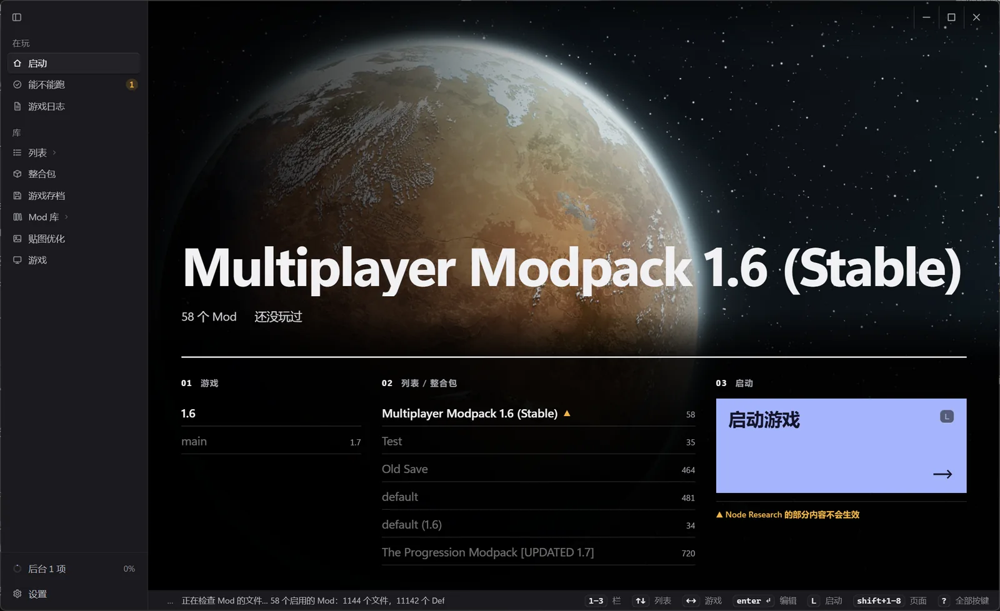
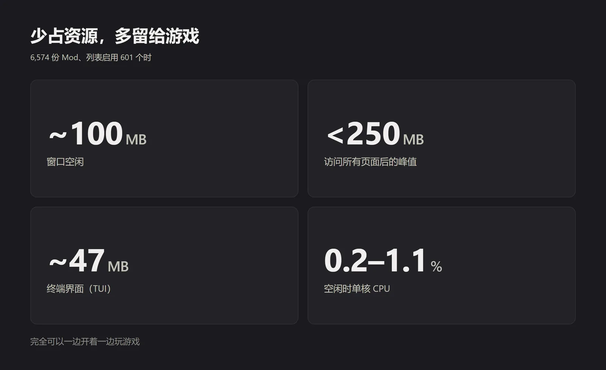
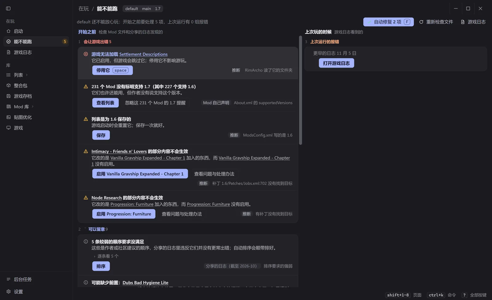
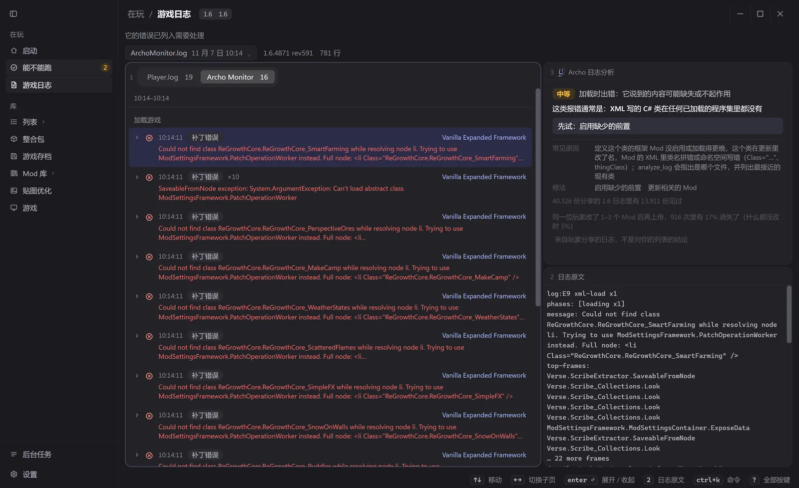
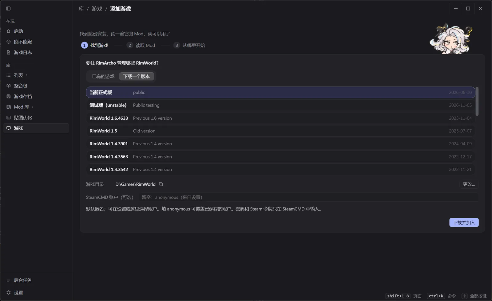
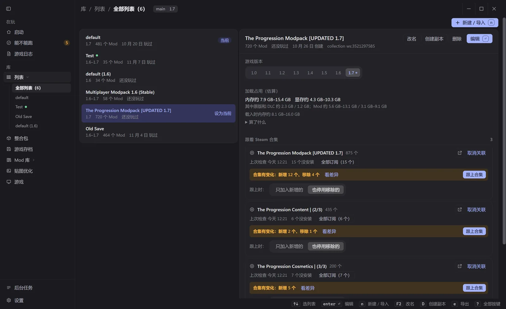
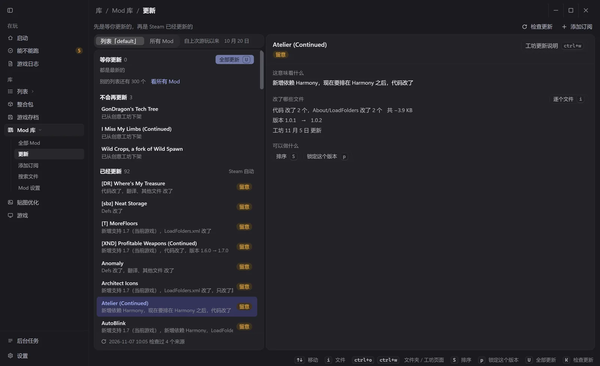
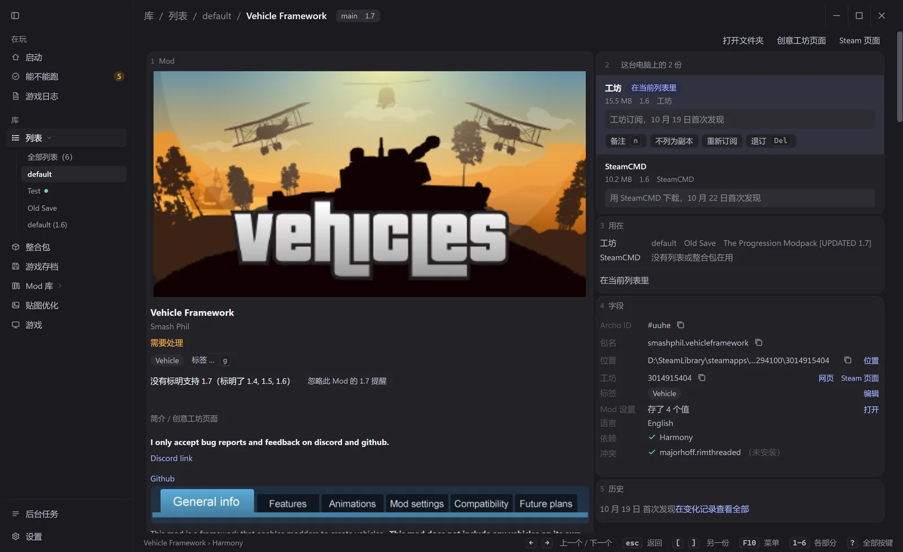
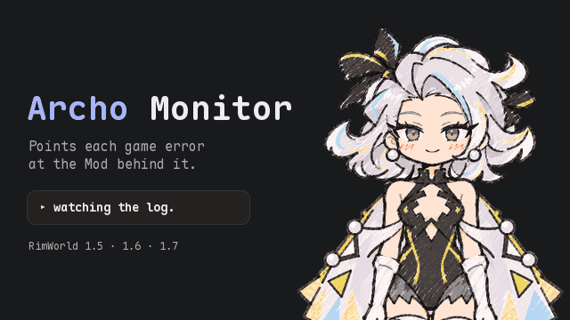
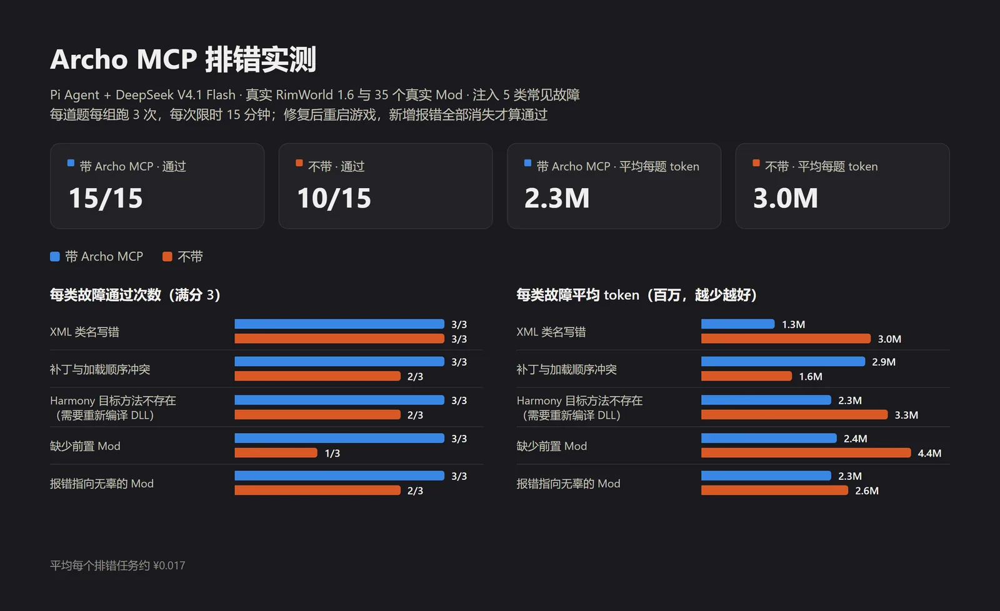

[English](README.md) | 简体中文

<div align="center">


# RimArcho

**不只管当前列表的 RimWorld 启动器和 Mod 管理器。**<br>
游戏版本、周目、存档一键切换。出了错，AI 自己启动游戏找到元凶，不用再花几个小时对半拆 Mod 列表。

[](https://github.com/ToumanLin/RimArcho/releases/latest)
[](https://github.com/ToumanLin/RimArcho/releases)
[](https://github.com/ToumanLin/RimArcho/actions/workflows/ci.yml)
[](LICENSE)
[](go.mod)
<br>
[-0078d4)](#安装)
[](https://rimworldgame.com/)
[](internal/l10ndata/locale)
[](#ai-agent-与-mcp)
[](https://discord.gg/HF2GVyurQs)
[](https://github.com/ToumanLin/RimArcho/stargazers)

[下载](https://github.com/ToumanLin/RimArcho/releases/latest) ·
[用户指南](UserGuide/user-guide.zh-CN.md) ·
[更新日志](CHANGELOG.md) ·
[Discord](https://discord.gg/HF2GVyurQs)

</div>



我玩 RimWorld 有 1600 小时了。相信不少人和我一样：想玩游戏，结果大部分时间花在了整理 Mod 列表、反复启动和排查报错上。RimArcho 就是为了把这些时间还给你。它免费、开源，使用 MIT 许可证。

## 目录

- [亮点](#亮点)
- [启动前体检](#启动前体检)
- [列表和游戏](#列表和游戏)
- [Mod 库](#mod-库)
- [存档](#存档)
- [Archo Monitor](#archo-monitor)
- [AI agent 与 MCP](#ai-agent-与-mcp)
- [安装](#安装)
- [隐私与安全](#隐私与安全)
- [代码签名政策](#代码签名政策code-signing-policy)
- [常见问题](#常见问题)
- [链接](#链接)

## 亮点

- **轻量**：6574 份 Mod、列表启用 601 个 Mod 时，空闲约 100 MB，访问所有页面后峰值 <250 MB，终端界面约 47 MB，空闲 CPU 占用仅为单核的 0.2–1.1%。完全可以一边开着一边打游戏。
- **用真实数据打磨**：排序和冲突检测用 40,326 份玩家报错日志和 5143 个 Mod 反复迭代。
- **能不能跑？** 游戏启动前检查依赖、加载顺序、补丁、Harmony 补丁、内存和你上次的存档。
- **看得懂的日志**：报错按类归组、标出严重程度，并指向背后的 Mod。
- **列表和游戏**：多个列表、多个游戏实例（1.6 和 1.7 并存）共用一套 Mod，每次改动都能撤销。
- **一个程序，三种用法**：桌面窗口、终端界面、可写脚本的 CLI，以及给 AI agent 用的 MCP 服务，看到的是同一套事实。
- **带上你的数据**：可从 RimSort、RimCrow、RimPy 和 RimStack 导入列表、规则和数据。

<p align="center"></p>

## 启动前体检

**能不能跑**会在游戏之前先看一遍你的列表：

- **排序。** RimArcho 用共享日志迭代出了自己的排序算法，并会说明它遵循的每条约束；还会提示哪些 Mod 在一起容易出错，并建议停用其中一个。
- **静态检查。** 缺少或未启用的前置、不兼容、加载顺序。按游戏的方式合并和继承 Def、模拟 PatchOperation，补丁失败时给出原因。直接从 Mod 的程序集（DLL）读取 Harmony 补丁。这一步覆盖不了只在运行时出现的冲突，但能提前发现很多问题。
- **你的存档。** 读取上次存档用到的 Mod 并和当前列表对比，告诉你改了列表之后它还能不能加载。
- **内存。** 估算列表需要的内存和显存，电脑带不动时提前警告，不用等 20 分钟加载完再崩溃。



**游戏日志。** RimArcho 读取游戏运行时写的日志并总结哪里出了问题，不用在上万行日志里迷失自我。根据 40,326 份日志，每类报错都标注了严重程度：满屏红字黄字大多可以放心忽略，真正需要处理的会被挑出来，并附上背后的 Mod、证据和建议先试的办法。



## 列表和游戏

支持多个列表，多个游戏实例共用一套下载好的 Mod。RimArcho 把 Mod 链接进每个游戏（Windows 上是目录联接，Linux 上是符号链接），一份 Mod 可以在所有实例里使用，RimWorld 1.6 和 1.7 也能并存。还能用 SteamCMD 下载其他游戏版本。



列表可以跟随 Steam 合集，合集变化时一键跟上。列表历史记录每一次改动，随时可以回滚。**锁定版本**会把正在用的 Mod 复制成锁定副本，Steam 的自动更新不会覆盖它。



## Mod 库

RimArcho 展示每个 Mod 更新了什么，不用再看着“正在更新 RimWorld：Steam 工坊”发呆，猜是哪个 Mod 被更新了。



详情页直接显示 Steam 工坊的介绍，而不是大多数作者懒得写的 About.xml；还列出这个 Mod 的每份副本和用到它的列表。



- 支持从 Steam 工坊、GitHub 和 LoversLab 链接直接添加 Mod，这些 Mod 有更新时跟着更新。
- 贴图优化用 [todds](https://github.com/joseasoler/todds) 把 Mod 里的 PNG 转成 DDS，降低游戏内存占用。PNG 会保留，RimArcho 也能把 DDS 全部撤回。
- 搜索所有 Mod 的文件；不用启动游戏就能改 Mod 配置。

## 存档

存档按殖民地分组展示，不用再看着“New Arrival 43”却不知道这是啥。殖民地分组支持 RimSaves 的文件名。RimArcho 会读出每个存档用到的 Mod，告诉你去掉某个 Mod 会不会丢失内容、存档还能不能正常加载。

## Archo Monitor



Archo Monitor 是 RimArcho 的游戏内辅助 Mod，随每个版本一起提供，并会自动加入你的列表。它记录 `Player.log` 说不出的事：报错时正在加载哪个 XML 文件和 Def，调用栈上的代码和 Harmony 补丁属于哪个 Mod，以及游戏停止写日志之后又出现了多少报错。RimArcho 读它的日志，为每个问题给出证据。

它不改动游戏里的任何东西，随时可以添加或移除，几乎没有性能开销。不装 RimArcho 也能用：在它的 Mod 设置里点 **按 Mod 查看错误…**，就能看到本次运行的错误按 Mod 分组。支持 RimWorld 1.5、1.6 和 1.7，需要 Harmony。

<br clear="right">

## AI agent 与 MCP

所有功能都不需要 AI。AI agent 是 RimArcho 的第二类用户：通过 MCP，它们拿到和你相同的事实、执行相同的动作，也遵守相同的规则。列表保存或启动之前不会写入游戏，改动都能撤销。内置的 AI agent 也在路上。

**要配置它，只需要把这份 README 发给你的 AI agent**（Codex、Claude Code、Pi Agent、DeepSeek Harness……），它会按[安装](#安装)和[接入 agent](#接入-agentarcho-mcp)自己装好。

MCP 服务内置 47 个工具，渐进式披露（默认提供 30 个）：读取 Mod、Def、补丁、Harmony 补丁、日志、Mod 配置、存档和 C# 源码；编辑、保存和启动列表；自动启动游戏的试运行。RimArcho 还提供 [RimWorld Probe 技能](skills/rimworld-probe/SKILL.md)，让 agent 创建小型测试 Mod，在游戏里运行，检查某个行为的实际结果。

**Archo MCP 排错实测。** 在 Pi Agent 中用 DeepSeek V4.1 Flash 做 A/B 测试。测试环境是真实的 RimWorld 1.6 和 35 个真实 Mod，注入 5 类常见故障。agent 要找出出问题的 Mod 并交上修复；修复后重启游戏，新增的报错全部消失才算通过。每道题每组跑 3 次，每次限时 15 分钟。

| 故障 | 带 Archo MCP | 不带 |
| --- | --- | --- |
| XML 类名写错 | 3/3 · 1.3M token | 3/3 · 3.0M |
| 补丁与加载顺序冲突 | 3/3 · 2.9M | 2/3 · 1.6M |
| Harmony 补丁的目标方法不存在（需要重新编译 DLL） | 3/3 · 2.3M | 2/3 · 3.3M |
| 缺少前置 Mod | 3/3 · 2.4M | 1/3 · 4.4M |
| 报错指向无辜的 Mod | 3/3 · 2.3M | 2/3 · 2.6M |
| **合计** | **15/15** · 平均 2.3M | 10/15 · 平均 3.0M |

Archo MCP 让 agent 更会找错、修错，token 也用得更少：平均每个排错任务约 ¥0.017。

<p align="center"></p>

## 安装

### 系统要求

| 平台 | 需要 |
|---|---|
| Windows | Windows 10 或 11，64 位。窗口需要 Microsoft Edge WebView2，这两个系统都自带。 |
| Linux（实验性） | `archo`（终端界面、CLI、MCP）不需要安装任何东西。窗口 `rimarcho` 需要 GTK 3 和 WebKitGTK 4.1（Ubuntu 22.04、Debian 12、Fedora 40 或更新）。能找到原生、Proton 和 Flatpak 版 Steam 的游戏。 |
| RimWorld | 1.6 和 1.7（Steam、SteamCMD 或无 DRM 版）。 |
| 可选 | [ilspycmd](https://github.com/icsharpcode/ILSpy)（需要 .NET SDK），用于读取 Mod 的 C# 代码；RimArcho 不会替你安装。 |

### Windows

1. 从 [GitHub Releases](https://github.com/ToumanLin/RimArcho/releases/latest) 下载 `archo-<版本号>-windows-amd64.zip`（GitHub 打不开时，可以从[蓝奏云](https://rimarcho.lanzn.com/b01i608qja)下载，密码 `ctot`）。
2. **新用户：** 找个目录解压，例如 `C:\Tools\RimArcho\`，双击 `RimArcho.exe`。首次运行向导会找到你的游戏，读一遍 Mod，并提出从游戏、RimSort、RimCrow、RimPy 或 RimStack 带上你的列表。
3. **老用户：** RimArcho 会自己更新（设置 › 关于，或 `archo update`）。手动更新的话，用新的 `RimArcho.exe` 和 `archo.exe` 替换旧的即可。
4. 可选：把这个目录加入 `PATH`，就能在任何终端输入 `archo`。

签名配置好之后，发布的 exe 都带代码签名（见[代码签名政策](#代码签名政策code-signing-policy)）。首次运行没有签名的版本时，Windows 可能提示“Windows 已保护你的电脑”：选“更多信息”，再选“仍要运行”。每个版本都附带 `.sha256` 校验文件，你也可以用这份源码自己构建（见下文）。如果提示没有权限、用管理员运行也不行，见常见问题“RimArcho.exe 打不开”。

### Linux（实验性）

下载 `archo-<版本号>-linux-amd64.tar.gz`，解压到任意位置，运行 `./archo`（终端界面）或 `./rimarcho`（窗口）。Linux 支持刚加入，仍在测试中，可能有些粗糙，请备份好存档和 Mod 列表。Linux 上 RimArcho 不会自动更新；`archo update` 会显示新版本和安装方法。贴图优化需要 `PATH` 上有原生的 `todds`。遇到问题欢迎在 GitHub 反馈。

### 从源码构建

需要 Go 1.27 或更新：`go build -o archo.exe ./cmd/archo`；或 `pwsh scripts/release.ps1 -Version x.y.z` 生成带版本号的发布 zip。架构和规格在 [docs/](docs/README.md)（英文）。

### 命令行首次运行

```
archo env detect                 # 找到游戏、用户数据目录和工坊目录
archo env add main --detected    # 把它们注册为游戏配置 "main"
archo scan                       # 读取所有 Mod 文件夹（之后是增量扫描）
archo status                     # 概览：Mod、列表、问题数量
archo problems                   # 有什么问题，最严重的在前
archo log                        # 归因最新的 Player.log
```

然后双击 `RimArcho.exe` 打开窗口，或运行 `archo` 打开终端界面。`archo help` 列出所有命令；`archo <命令> --help` 显示它的参数。

### 接入 agent（`archo mcp`）

`archo mcp` 通过 stdio 提供 RimArcho 的工具。默认提供 agent 诊断和修复 Mod 列表所需的核心工具。`archo mcp --tools all` 还会提供玩家的管理工具（整合包、订阅、Mod 库操作、贴图、内存估算、维护、身份、隐藏的 Mod、链接、标签和备注、卸载预览）；只在需要 agent 做这些时才加，因为每个工具每一轮都占用上下文。每个工具返回的内容和对应 CLI 命令的输出完全相同；只读工具标注 `readOnlyHint`，会写入游戏或 Mod 文件的工具标注 `destructiveHint`。

**Claude Code**，在终端里：

```
claude mcp add rimarcho -- C:\Tools\RimArcho\archo.exe mcp
```

或写进项目的 `.mcp.json`：

```json
{
  "mcpServers": {
    "rimarcho": { "command": "C:\\Tools\\RimArcho\\archo.exe", "args": ["mcp"] }
  }
}
```

**Codex**，写进 `~/.codex/config.toml`：

```toml
[mcp_servers.rimarcho]
command = 'C:\Tools\RimArcho\archo.exe'
args = ["mcp"]
```

`"args": ["mcp", "--tools", "all"]` 会同时提供管理工具。然后就可以问，比如：“我的日志里有 `Patch operation … failed` 报错，是哪个 Mod 的问题？”或者直接贴一段调用栈。工具调用可以传 `env` 使用另一个游戏配置，传 `game_version` 按另一个游戏版本分析。`guide` 工具给出每个工具的完整说明，agent 不需要额外的技能。

<details>
<summary><b>按键（窗口和终端）</b></summary>

两种界面遵守同一套规则：**方向键只负责移动**，从不改动任何东西；**会改动的键立即作用**于选中项，`u` 撤销。

| 按键 | |
|---|---|
| `↑/↓`、`←/→`、`1`–`4` | 移动光标；跳到未启用、已启用、暂存、详情 |
| `shift+↑/↓`、`ctrl+space` | 选一段；选中或取消一个 |
| `space` | 启用 / 停用 / 从暂存放回 |
| `t`、`T` | 暂存（或放回）；全部放回 |
| `m`、`J` / `K` | 移到某个位置或某个 Mod 之后；下移 / 上移 |
| `enter`、`o` | 完整详情；工坊页面 |
| `S` / `w` / `L` | 排序 / 保存到游戏 / 启动（都会先显示预览） |
| `u` / `ctrl+r` | 撤销 / 重做（窗口也支持 `ctrl+z` / `ctrl+y`） |
| `/` | 搜索：关键词、`tag:`、`author:`、`type:`、`has:`、`location:`、`-not` |
| `ctrl+k`、`?` | 命令面板；全部按键 |

窗口里鼠标也一样：单击、`shift`/`ctrl`+单击、双击启用或停用、在列表之间或已启用列表内部拖动、右键查看能对这个 Mod 做什么。

</details>

## 隐私与安全

RimArcho 的设计原则是尊重你的文件。它会写入的全部内容，以及卸载如何逐项撤销，见 [02 · 文件写入与卸载](docs/specs/02-file-writes-and-uninstall.md)（英文）。

**它会动什么**

- **`ModsConfig.xml`**，只在你保存或启动列表时写入。旧文件作为备份留在旁边，新文件原子替换。
- **游戏 `Mods/` 文件夹里的链接**，名字以 `_Archo_` 开头，指向 SteamCMD、额外目录里的 Mod 和随附的 Archo Monitor。它只创建和删除带这个前缀的链接，从不写入链接目标。
- **你要求的操作：** Mod 的锁定副本、PNG 旁边的 DDS 贴图、Mod 配置的值（先把文件复制为 `.rimarcho.bak`）、存档的重命名和复制。
- **它自己的数据：** `%APPDATA%\RimArcho\`（数据库、列表历史、缓存）和托管目录 `%LOCALAPPDATA%\RimArcho\`（SteamCMD、工具、下载的 Mod），Linux 上是 XDG 目录。

**它从不做什么**

- 没有遥测、没有统计、没有崩溃上报。所有联网行为以及关闭方法见下文。
- Steam 密码和 Steam 令牌验证码只会输入到你电脑上的 SteamCMD 窗口里。SteamCMD 要求输入时，你可以交给 RimArcho 代为输入到那个窗口（也可以自己在窗口里输入）。它们从不保存、不写入日志、不经网络发送，也不会出现在反馈报告里。LoversLab 只在网站自己的页面里登录。
- 从不永久删除你的内容：移除的 Mod、存档、整合包和设置文件都进回收站，列表的每次改动都能撤销。
- AI agent 的改动和你的一样，只有在列表保存或启动时才会写入游戏；agent 也被要求在任何写入前先征得你的同意。
- 反馈报告只在你点击发送时才会发出，发送前你能看到全部内容。

### 哪些内容会联网

除了你亲自发送的反馈报告，RimArcho 不向作者发送任何东西。它的全部联网行为都列在这里。大多数请求带有请求头 `RimArcho (+https://github.com/ToumanLin/RimArcho)`，和任何连接一样也会带上你的 IP 地址。开关在设置里，或用 `archo config set <键> <值>` 设置。

**自动进行的**，只在窗口或 `archo tui` 打开时（命令行和 `archo mcp` 从不）：自动检查在启动 20 秒后开始，除注明外每项每天最多一次。`updates.auto off`（设置 › 关于，“自动检查更新”）会全部停止。它们不能逐项关闭；`updates.interval` 只改变频率。

| 内容 | 发往 | 发送什么 | 另可关闭的方式 |
| --- | --- | --- | --- |
| RimArcho 更新检查 | `api.github.com`；Windows 上还有 `api.steampowered.com`（Archo Monitor 物品的介绍）和蓝奏云分享（`rimarcho.lanzn.com`、`apifile.woozooo.com`、`developer4.lanrar.com`） | 不含你的信息 | `updates.source github` 只用 GitHub |
| Mod 更新检查 | `api.steampowered.com`；你从 Git、下载页、LoversLab 订阅的 Mod 所在的网站 | 用 SteamCMD 下载的 Mod 的工坊 ID；对 LoversLab，若你连接了账号，会带上你的 LoversLab 会话 | — |
| LoversLab 会话续期（每 4 小时） | `www.loverslab.com` | 你的 LoversLab 会话，仅在你连接了账号时 | 断开账号 |
| 工具版本（每周；只查 RimArcho 安装的工具） | Valve 的 SteamCMD 更新服务器、`api.github.com`（todds） | 不含你的信息 | — |
| 社区数据：排序规则、Steam 数据库、替代 Mod | `raw.githubusercontent.com` | 不含你的信息 | 把 `data.rules.url`、`data.steamdb.url`、`data.replacements.url` 设为本地文件 |
| Archo Monitor 更新 | `api.steampowered.com`，然后 SteamCMD 匿名登录 | 不含你的信息 | — |
| 你发送过的反馈的回复（窗口启动时和打开反馈页时） | 反馈中转站 `rimarcho-feedback.toumanlin.workers.dev` | 报告编号和它的回复令牌 | `feedback.replies off` |

**你查看或操作时才会进行的：**

| 内容 | 发往 | 发送什么 | 关闭方式 |
| --- | --- | --- | --- |
| 选中 Mod 时读取它的工坊介绍 | `api.steampowered.com` | 它的工坊 ID | `workshop.fetch off` |
| 介绍里的图片 | Mod 作者使用的图床 | 普通的图片请求 | `workshop.images off`（或 `workshop.fetch off`） |
| 合集：导入合集，以及打开“全部列表”时重新读取列表关注的合集 | `api.steampowered.com` | 合集 ID | 没有开关（取消关注该合集） |
| 订阅、下载 Mod 或游戏 | SteamCMD 和 Steam 客户端（它们自己连接 Valve）；`api.steampowered.com` | 工坊 ID；使用账号时的 Steam 账号名（密码只输入到你电脑上的 SteamCMD 窗口，RimArcho 不发送它） | 每次都由你发起 |
| 安装 SteamCMD、todds 或 RimArcho 更新 | Valve 的 SteamCMD 下载、GitHub（更新还有蓝奏云） | 不含你的信息 | 每次都由你发起 |
| 反馈报告 | 反馈中转站，它会建成一个**公开的** GitHub issue | 你写的内容、你留的联系方式（不放进 issue），以及你勾选的信息：版本、系统、启用的 Mod、日志错误、隐去用户名的路径 | 你看过内容并点发送 |
| 写功能建议时列出已有建议 | 反馈中转站 | 不含你的信息 | 没有开关 |
| 导入 Rentry 列表 | `rentry.co` | 页面 ID | 由你发起 |

**怎样连接。** 默认走 Windows 代理（`network.proxy`：`system`、`off` 或代理地址）。GitHub 请求失败时会改走公共 GitHub 镜像（`gh-proxy.com`、`ghfast.top`、`ghproxy.net`），镜像能看到所请求的 GitHub 地址；RimArcho 自身的更新信息和校验文件从不经过镜像。`network.github_mirror off` 可关闭。请求失败且没有设置代理时，RimArcho 会试探你本机（127.0.0.1）上常见的代理端口。蓝奏云直接连接、不走代理；RimArcho 会回答它简单的防机器人校验（固定计算，不运行网页脚本），并且和读取你订阅的下载页时一样，发送浏览器的 User-Agent。从 Git 订阅的 Mod 检查更新时不使用代理设置。你打开的链接交给你的浏览器。

游戏内 Mod [Archo Monitor](#archo-monitor) 没有任何联网代码：它只把日志写在你的存档旁边。RimArcho 不修改 Windows 设置，只读取注册表（代理设置、Steam 所在目录）。

**卸载**（设置里，或 `archo uninstall`）会先列出要移除的内容，再移除它的链接和数据，你的游戏、Mod 和存档保持原样。

## 代码签名政策（Code signing policy）

Free code signing provided by [SignPath.io](https://about.signpath.io), certificate by [SignPath Foundation](https://signpath.org).（免费代码签名由 SignPath.io 提供，证书由 SignPath Foundation 颁发。）

- Windows 版由 GitHub Actions 从本仓库构建（[`windows-release`](.github/workflows/ci.yml)），只有这些构建会送去签名，每个版本都要人工批准后才签名。签名的是 `archo.exe`、`RimArcho.exe` 和 Archo Monitor 的 `ArchoMonitor.dll`，发布者显示为 SignPath Foundation。签名配置好之前的版本没有签名。
- 提交者和审核者（Committers and reviewers）：[ToumanLin](https://github.com/ToumanLin)
- 批准者（Approvers）：[ToumanLin](https://github.com/ToumanLin)
- 隐私：见[哪些内容会联网](#哪些内容会联网)。除了那里列出的自动检查（`archo config set updates.auto off` 可关闭），本程序不会向其他网络系统传输任何信息，除非使用者或安装、运行它的人明确要求。

## 常见问题

<details>
<summary><b>Windows 提示“Windows 已保护你的电脑”。</b></summary>

这个版本没有代码签名（见[代码签名政策](#代码签名政策code-signing-policy)）。选“更多信息”，再选“仍要运行”。你可以用 `.sha256` 文件核对下载，或自己从源码构建。
</details>

<details>
<summary><b>RimArcho.exe 打不开：提示“没有权限”，用管理员运行也不行。</b></summary>

RimArcho 不需要任何特殊权限，也从不需要管理员权限。刚下载的、没有代码签名的程序被拦下时，Windows 或杀毒软件会提示“Windows 无法访问指定设备、路径或文件。你可能没有适当的权限访问该项目”，用管理员运行也绕不过去。按顺序试：

1. **先解压 ZIP。** 不要在压缩包窗口里直接运行 exe。解压前右键 ZIP，选“属性”，勾选“解除锁定”（如果有），点“确定”。解压到普通目录，比如 `D:\Games\RimArcho`，不要放进 `Program Files`。
2. **杀毒软件。** 如果杀毒软件隔离或拦截了 `RimArcho.exe` 或 `archo.exe`，把它们恢复，并把 RimArcho 目录加入信任。想确认文件没被改过，可以先用 `.sha256` 文件核对 ZIP。
3. **智能应用控制**（Windows 11：设置 › 隐私和安全性 › Windows 安全中心 › 应用和浏览器控制）。开启时它会拦下所有没有签名的程序，且无法单独放行；关掉后不重置系统就开不回来。我们正在申请免费的代码签名来解决这个问题；在那之前，开着它就无法运行 RimArcho。

还是打不开？把完整提示（最好截图）和 Windows 版本发到 [GitHub issues](https://github.com/ToumanLin/RimArcho/issues) 或 Discord。
</details>

<details>
<summary><b>需要放弃 RimSort、RimCrow、RimPy 或 RimStack 吗？</b></summary>

不需要。首次运行向导（以及 `archo import`）会读取它们的列表、规则和数据，在改动任何东西之前先展示会导入什么。RimArcho 从不写入它们的文件。
</details>

<details>
<summary><b>会弄坏我的存档或 Mod 列表吗？</b></summary>

保存或启动列表之前，什么都不会写入游戏；每次编辑都能从列表历史里撤销。能不能跑会告诉你，上次的存档在你要玩的列表下还能不能加载。
</details>

<details>
<summary><b>能同时装 RimWorld 1.6 和 1.7 吗？</b></summary>

能。把每个安装添加为单独的游戏配置（或用 SteamCMD 下载另一个版本）；它们共用一套下载好的 Mod，各自有自己的列表。
</details>

<details>
<summary><b>一定要用 AI 吗？</b></summary>

不用。所有功能都不需要 AI。MCP 是给想让 agent 帮忙诊断和修复 Mod 列表的玩家准备的。
</details>

<details>
<summary><b>我的列表里为什么多了一个 Archo Monitor？</b></summary>

它是 RimArcho 的游戏内辅助 Mod（见 [Archo Monitor](#archo-monitor)），为报错记录证据，不改动游戏里的任何东西。设置 › 游戏日志 › “自动把 Archo Monitor 加进列表”可以关闭自动加入，你也可以从任何列表里移除它。
</details>

<details>
<summary><b>我的文件在哪里？</b></summary>

| 内容 | 位置 |
|---|---|
| RimArcho 数据 | `%APPDATA%\RimArcho\`（数据库、列表历史、反编译缓存） |
| 托管目录 | `%LOCALAPPDATA%\RimArcho\`（SteamCMD、工具、下载的 Mod；可以移动） |
| 它写入的游戏文件 | `<用户数据>\Config\ModsConfig.xml`，只在保存或启动时写入；旁边会留一份备份 |
</details>

## 链接

- [Releases](https://github.com/ToumanLin/RimArcho/releases) · [蓝奏云镜像](https://rimarcho.lanzn.com/b01i608qja)（密码 `ctot`）
- [用户指南](UserGuide/user-guide.zh-CN.md)（[English](UserGuide/user-guide.md)）
- [更新日志](CHANGELOG.md)（英文）
- [Discord](https://discord.gg/HF2GVyurQs) · [Issues](https://github.com/ToumanLin/RimArcho/issues)
- [设计与规格](docs/README.md)（英文）

如果你觉得好用，去 GitHub 点个 star，能帮更多玩家找到它。非常感谢！

## 许可证

[MIT](LICENSE) © Touman Lin。RimArcho 是玩家制作的工具，与 Ludeon Studios 无关。
