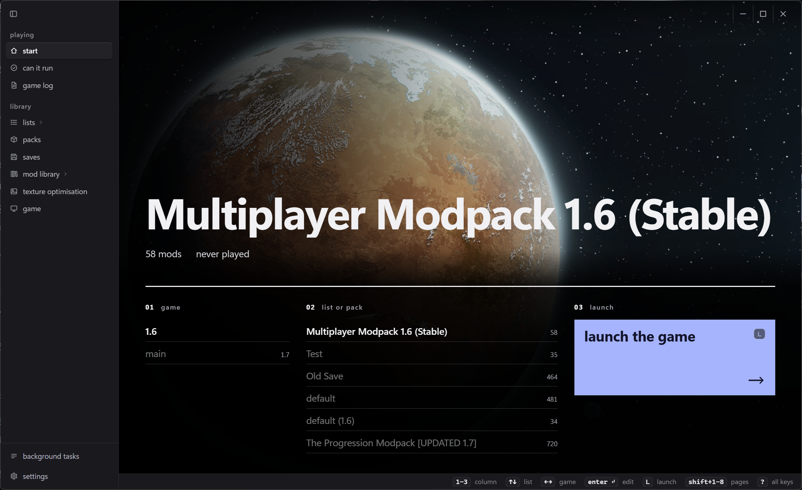
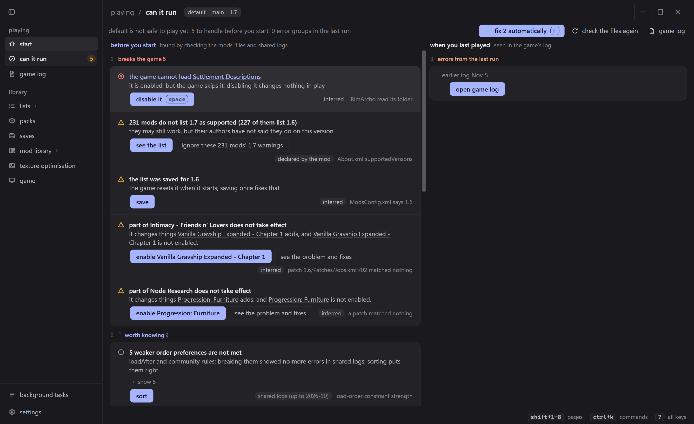
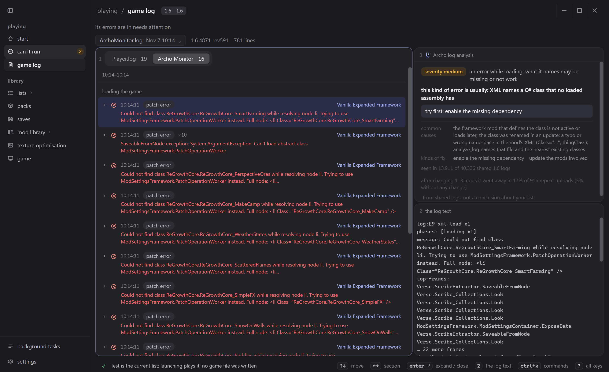
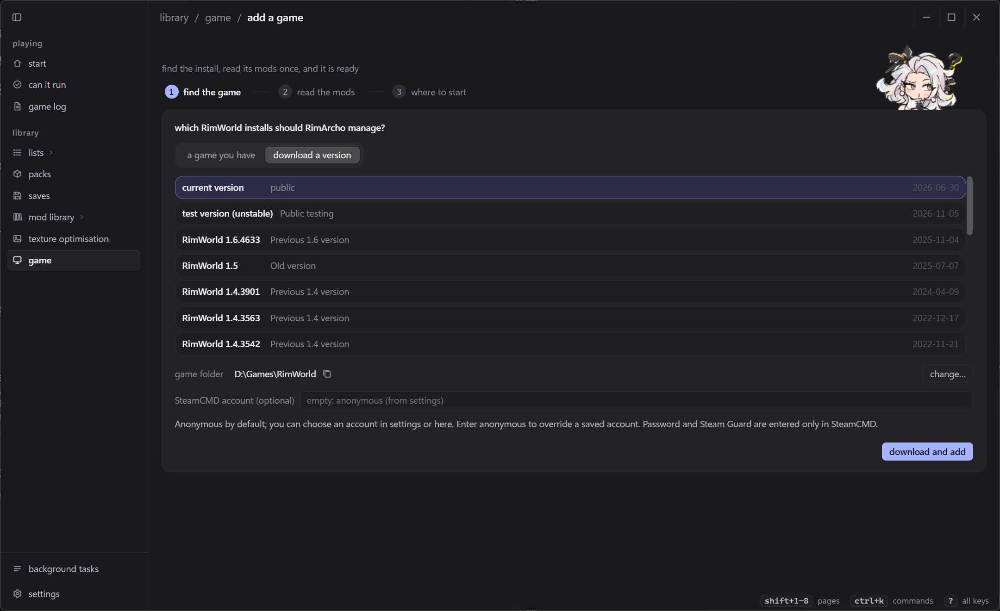
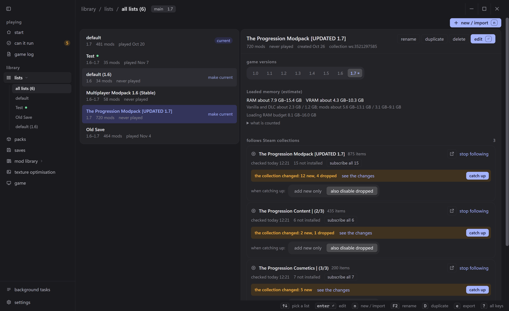
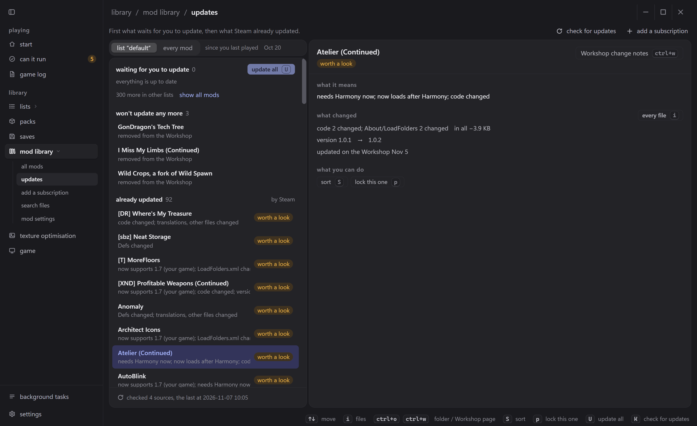
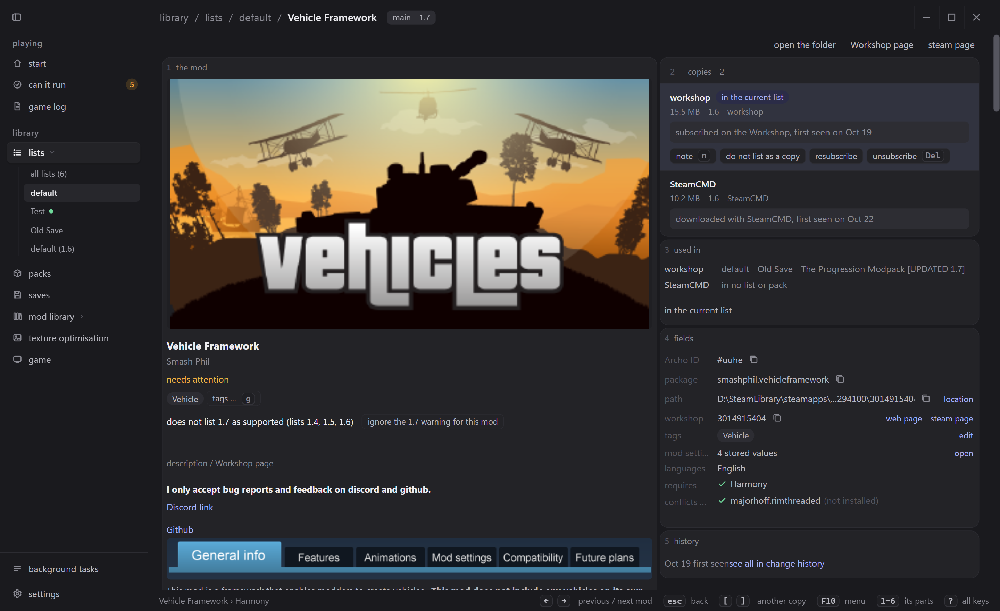
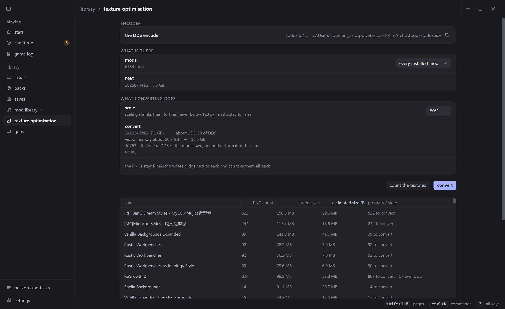
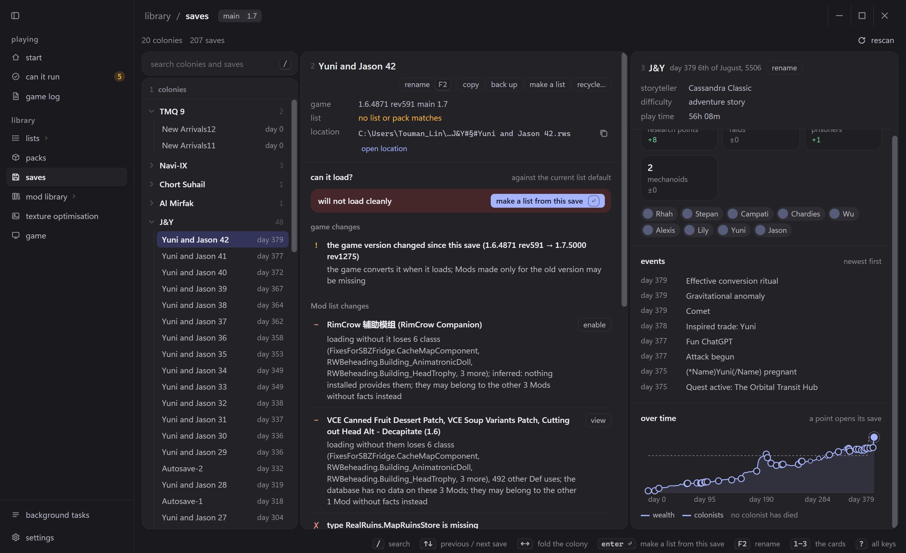

I've played RimWorld for 1,600 hours. I suspect many of you are like me: you sit down to play, and 90% of the time goes into sorting the Mod list, relaunching and chasing errors. So I made RimArcho, a clean, fast, lightweight launcher with a simple goal: less fussing with Mods, less digging through errors, more playing.

RimArcho is fully open source: https://github.com/ToumanLin/RimArcho

Questions or suggestions? Join us on Discord: https://discord.gg/HF2GVyurQs

If you find it useful, please give it a thumbs-up, add it to your favourites and star it on GitHub. Thank you!

### How to use

Once you subscribe, Steam downloads `archo-<version>-windows-amd64.zip` to `<Steam folder>\steamapps\workshop\content\294100\3835688284\`. You can also download it from GitHub Releases.

1. New users: unzip it into any folder and double-click RimArcho.exe.
2. Existing users: replace your old RimArcho.exe and archo.exe with the new ones.

The executables are not code-signed, so the first time you run one Windows may say "Windows protected your PC": choose More info, then Run anyway.

RimArcho is built to be light:
with 6,574 Mod copies and 601 Mods enabled, it idles at about 100 MB and peaks under 250 MB after visiting every page; the terminal UI (TUI) uses about 47 MB; at rest it uses only 0.2–1.1% of one CPU core.
You can leave it open while you play.

### A check-up before you launch

I collected 40,326 error logs shared by players and downloaded 5,143 Mods, and used them to iterate the sorting and conflict checks mechanism.

From that data RimArcho grew its own fast sorting algorithm. It also tells you which Mods tend to fail together and suggests disabling one of them.

RimArcho statically checks Mod assemblies (DLLs) for conflicts. It can't catch conflicts that only appear while the game runs, but it finds many problems in advance.

RimArcho reads which Mods your save uses and compares them with your current list, so you know whether your last save will still load after you change the list.

RimArcho estimates how much RAM and VRAM your list needs and warns you if your computer can't handle it, instead of crashing after a 20-minute load.

RimArcho reads the log the game writes while you play and sums up what went wrong, so you don't get lost in ten thousand lines. Based on the 40,326 logs, every kind of error gets a severity: most of the red and yellow text can safely be ignored, and the errors that need attention are picked out for you.

### Switch up how you play

Keep several lists, and let several game installs share one set of downloaded Mods. RimArcho links Mods into each game with symbolic links, so one copy of a Mod works in every install.

Lists can follow a Steam collection and update along with it, and you can import lists from RimSort and RimCrow. List history records every change, so you can roll back at any time.

Lock version copies the Mod you're using into a locked copy, so Steam's automatic updates can't overwrite it.

### Easy Mod management

RimArcho shows what each Mod update changed. No more staring at "Updating RimWorld: Steam Workshop" and wondering which Mod it was.

The details page shows the Steam Workshop description instead of the About.xml most modders never bother to fill in.

Add Mods straight from GitHub, LoversLab and Steam Workshop links, and they update when the Mods do.

Texture optimisation uses todds to convert the PNGs in your Mods to DDS, lowering the game's memory use.

### No need to start the game

Saves are grouped into colonies, so no more staring at "New Arrival 43" with no idea what it is. Colony grouping supports the RimSave format.

RimArcho reads which Mods a save uses and tells you whether removing one loses content and whether the save still loads.

RimArcho has an MCP server, and a built-in AI agent is on the way.

To use the MCP server, just give README.md to your AI agent, such as Codex, Claude Code, Pi Agent or DeepSeek Harness, and it installs everything itself.

The MCP server has 43 tools with progressive disclosure:
read Mods, Defs, patches, Harmony patches, logs, Mod settings, saves and C# source; edit, save and launch lists; and test runs that start the game automatically.

RimArcho also ships a Probe framework SKILL that lets AI agents build small test Mods, run them in the game and check what a behaviour actually does.

### Archo MCP troubleshooting test

An A/B test in Pi Agent with DeepSeek V4.1 Flash (1017), on a real RimWorld 1.6 with 35 real Mods and 5 kinds of common faults injected. The agent has to find the Mod at fault and submit a fix. A run passes only when every new error is gone after the game restarts. Each fault ran 3 times per group, 15 minutes per run.

| Fault | With Archo MCP | Without |
| --- | --- | --- |
| Misspelled XML class name | 3/3 · 1.3M tokens | 3/3 · 3.0M |
| Patch conflicts with load order | 3/3 · 2.9M | 2/3 · 1.6M |
| Harmony patch target method missing (DLL must be rebuilt) | 3/3 · 2.3M | 2/3 · 3.3M |
| Missing dependency | 3/3 · 2.4M | 1/3 · 4.4M |
| Error points at an innocent Mod | 3/3 · 2.3M | 2/3 · 2.6M |
| Total | 15/15 · average 2.3M | 10/15 · average 3.0M |

Archo MCP makes the AI much better at finding and fixing errors, and it uses fewer tokens too: about $0.003 per fix on average.
