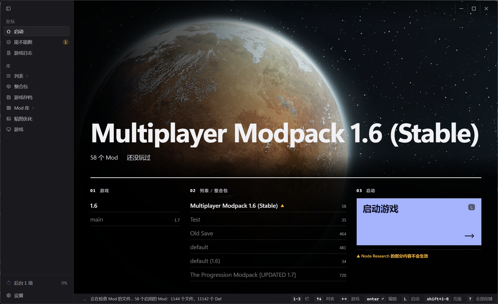
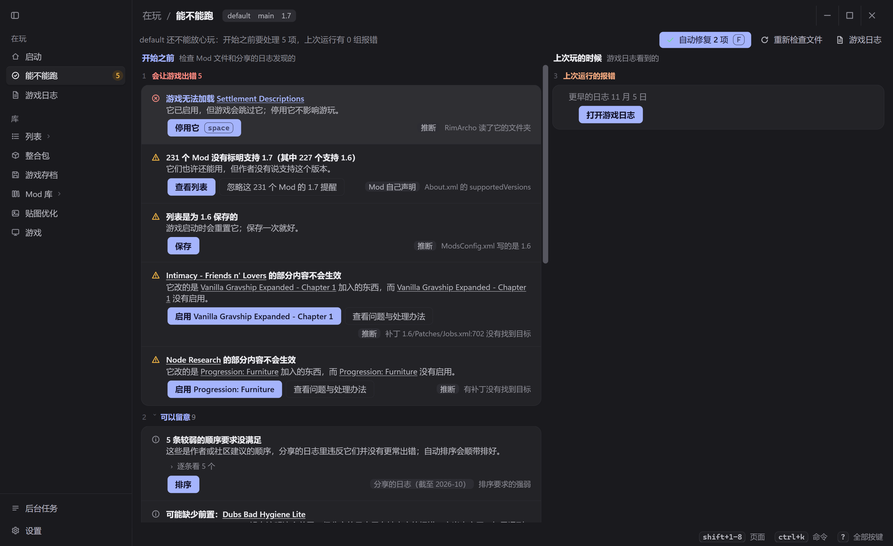
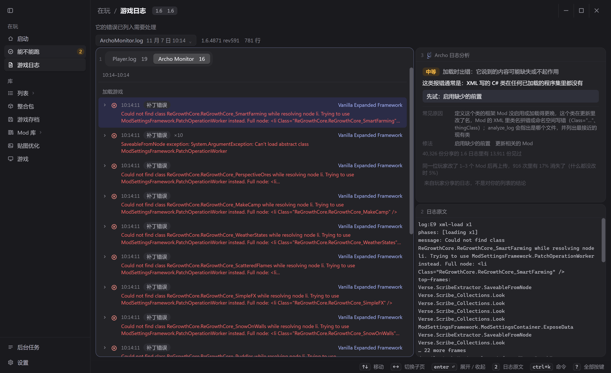
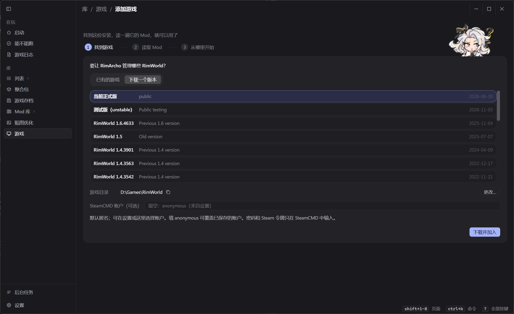
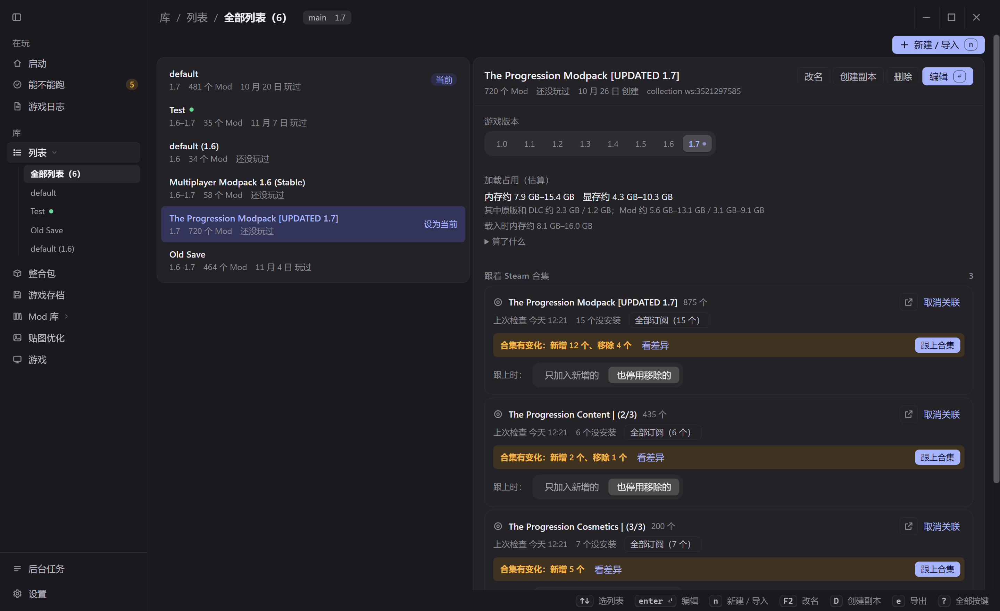
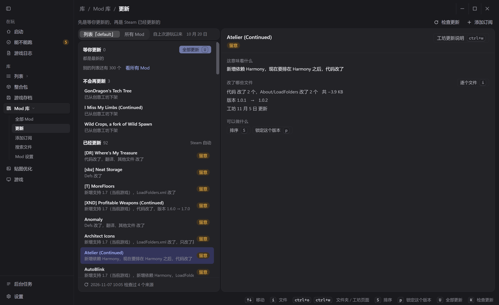
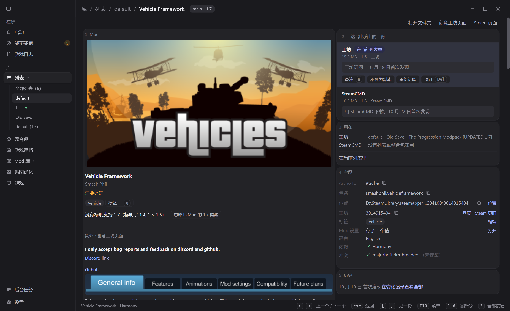
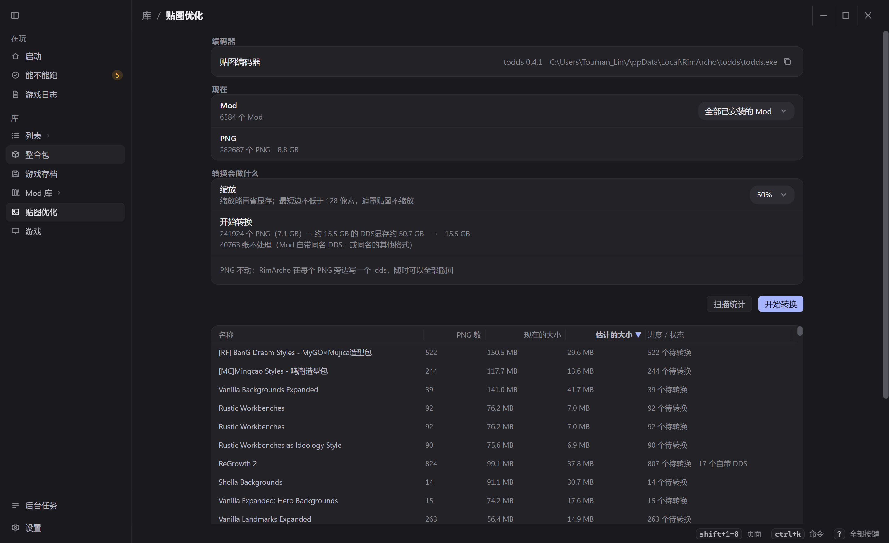
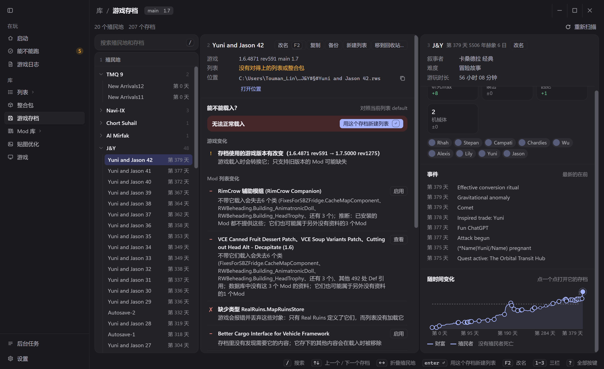

我玩RimWorld有1600小时了. 相信不少人和我一样, 想要玩游戏, 但结果90%的时间花在了整理mod列表, 反复启动和排除错误上. 所以我做了RimArcho, 一款优雅简洁高效占有小的启动器, 目标很简单: 少纠结Mod, 少查报错, 多玩游戏.

本启动器代码完全开源, 地址在 https://github.com/ToumanLin/RimArcho

如果你觉得好用, 不妨点个赞, 点个收藏, 去github给我点个star, 非常感谢!

RimArcho专门优化了性能: 
在拥有6574份Mod, 列表启用601个mod的情况下, 空闲占用~100MB, 访问所有页面后峰值占用<250MB; TUI模式下占用~47MB; 空闲CPU占用仅为单核的~0.2-1.1%
完全可以一边开着一边打游戏

### 启动前体检

我收集了4.8万份玩家报错日志, 下载了5143个Mod, 用这些数据反复迭代排序算法和冲突检测.

基于这些数据, RimArcho迭代出了属于自己的高效排序算法; 并且会提示哪些mod在一起可能出错, 并建议停用其中一个.

RimArcho能静态检查Mod程序集(dll)中的冲突, 这一步无法覆盖运行时冲突, 但是也能提前发现很多问题.

RimAcho能分析游戏存档使用的Mod, 并对比当前列表, 告诉你上一次加载的存档, 这一次改了Mod列表之后, 还能不能加载

RimArcho会估测Mod列表需要占用的内存/显存. 电脑带不动提前警告你, 不用再等20分钟加载再崩溃.

RimArcho能分析游玩中产生的日志, 并总结告诉你哪里出了问题, 不用费心在万行日志中迷失自我; 根据4.8万份日志, 给每类报错标注严重程度. 满屏红字黄字大部分可放心忽略, 真正需要处理的会挑出来.

### 换个游玩风格

支持多个列表, 多个游戏实例共用一套Mod下载. RimArcho通过软链接的方式管理Mod, 让一份Mod可以在不同游戏实例中使用.

列表管理支持订阅(follow)steam合集, 合集更新时候列表跟着更新; 也能从RimSort, RimCrow中导入. 列表历史记录每一次的改动, 随时可以回滚.

RimArcho提供的锁定版本功能, 允许玩家将当前使用的Mod复制为锁定版本, 避免steam自动更新覆盖.

### 轻松简单

RimArcho展示Mod更新的内容, 玩家再也不必看着"正在更新RimWorld:steam工坊"发呆并疑惑是哪个Mod被更新了

详情页直接显示Steam工坊介绍, 而不是Modder各个都懒得写的About.xml

支持从GitHub, LoversLab, Steam工坊链接直接添加Mod下载, 并且在这些mod有更新的时候自动更新

<!-- 备用图: assets/release-post/zh/10-subscribe.png（粘贴 GitHub 地址后的添加订阅页）。本栏已有 3 张，想换可以替掉上下任一张。 -->

贴图优化使用todds, 允许将Mod中的png转换成dds, 降低游戏内存占用

### 用不着启动游戏

存档管理将你的不同存档整理成不同殖民地展示, 再也不必看着"New Arrival 43"但完全不知道这是啥; 殖民地管理支持RimSave格式

RimArcho能分析这个存档使用了哪些mod, 去掉某个mod存档是否会丢失内容, 是否能正常启动

RimArcho迭代了MCP服务, 未来也会内置AI Agent.

要使用MCP服务, 只需要把Readme.md发给你的Ai Agent比如Codex, Claude Code, Pi Agent, DeepSeek Harness, 它们会自己安装

MCP服务内置43个工具, 并渐进式披露: 
读取Mod, Def, 补丁, Harmony补丁, 日志, mod设置, 存档和C#源码;编辑, 保存和启动列表; 自动启动游戏的试运行, 

RImArcho还提供Ai Agent用于操作游戏的Probe 框架 SKILL, 允许Ai Agent创建小型测试Mod, 在游戏中允许, 检查某个行为的实际结果.

### Archo MCP排错实测

在 Pi Agent 中用 DeepSeek V4.1 Flash（1017）做了 A/B 测试。测试环境是真实的 RimWorld 1.6 和真实的 35 个 Mod，在里面注入 5 类常见故障。agent 要找出出问题的 Mod，并交上修复。修复后重启游戏，新增的报错全部消失才算通过。每道题每组跑 3 次，每次限时 15 分钟。

| 故障 | 带 Archo MCP | 不带 |
| --- | --- | --- |
| XML 类名写错 | 3/3 · 1.3M token | 3/3 · 3.0M |
| 补丁与加载顺序冲突 | 3/3 · 2.9M | 2/3 · 1.6M |
| Harmony 补丁的目标方法不存在（需要重新编译 DLL） | 3/3 · 2.3M | 2/3 · 3.3M |
| 缺少前置 Mod | 3/3 · 2.4M | 1/3 · 4.4M |
| 报错指向无辜的 Mod | 3/3 · 2.3M | 2/3 · 2.6M |
| 合计 | 15/15 · 平均 2.3M | 10/15 · 平均 3.0M |

可见, Archo MCP不但让AI识别和修复错误的能力显著提高, 还降低了使用Token开销, 平均每个修复错误的任务消耗人民币~0.017.
